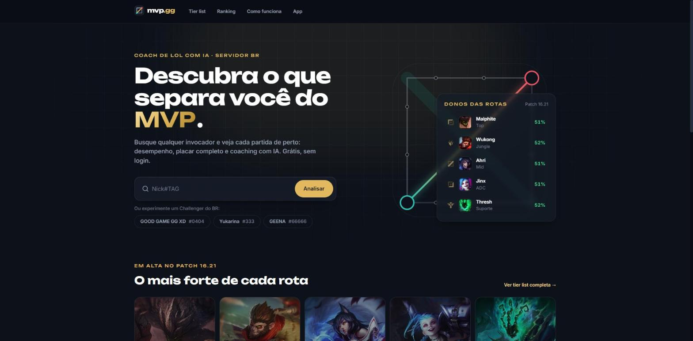
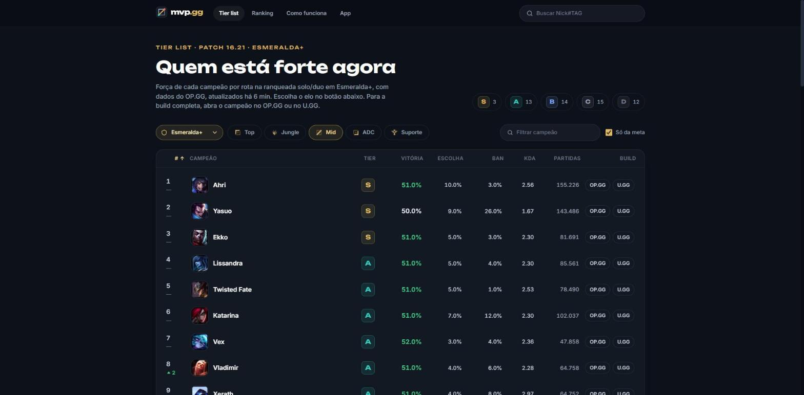
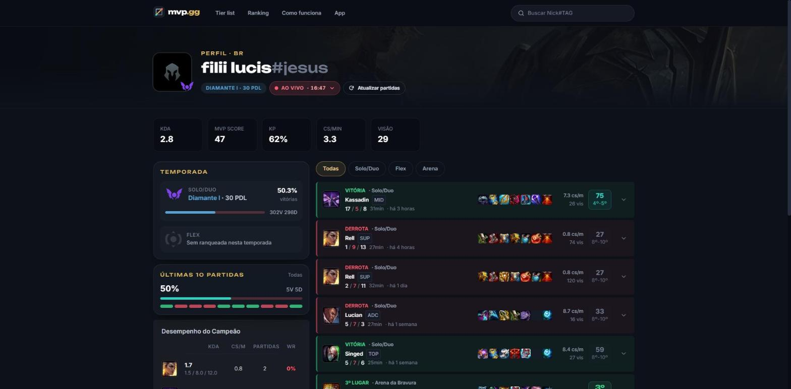

<div align="center">

# mvp.gg

**Coach de League of Legends com IA para o servidor BR.**
Busque qualquer invocador, veja cada partida de perto, acompanhe a meta por elo e receba coaching pós-jogo com IA.

[**mvpgg.vercel.app**](https://mvpgg.vercel.app)

</div>



## O que dá para fazer

- **Perfil do jogador** por Riot ID: elo da temporada (Solo/Duo e Flex, com PDL e winrate), forma recente, campeões mais jogados e o histórico com nota de desempenho por partida.
- **Filtros por modo** (Todas, Solo/Duo, Flex e Arena), com o nome oficial de cada fila e a colocação final nas partidas de Arena.
- **Partida ao vivo**: quando o jogador está em jogo, um botão mostra os dois times, campeões, feitiços e bans, com o cronômetro correndo.
- **Placar completo** de cada partida, com o jogador destacado entre os dez (ou entre os times do Arena).
- **Tier list por rota** com seletor de elo, do Ferro ao Desafiante, incluindo faixas como Ouro+ e Mestre+.
- **Ranking Challenger do BR**, com links para o perfil de cada jogador.
- **Coaching com IA**: um app para PC acompanha a partida e, no fim, a IA aponta erros e acertos que fizeram diferença no resultado.

| Tier list | Perfil |
|---|---|
|  |  |

## Arquitetura

```
              ┌─────────────────────────┐
  navegador → │ frontend (React + Vite) │ ── Vercel
              └────────────┬────────────┘
                           │ REST
              ┌────────────▼────────────┐      Riot API: account-v1, summoner-v4,
              │   backend (FastAPI)     │ ───► league-v4, match-v5, spectator-v5
              │                         │ ───► OP.GG MCP (tier list por rota e elo)
              │                         │ ───► Data Dragon / CommunityDragon
              │                         │ ───► Gemini e Claude (coaching)
              └──────┬──────────▲───────┘ ── Render
                     │          │
              Supabase (cache   │ upload pós-jogo
              das análises)     │
                          ┌─────┴──────────────┐
                          │ app de PC (MVPApp) │ ── lê a Live Client Data API
                          └────────────────────┘    do jogo (localhost:2999)
```

| Parte | Stack |
|---|---|
| Frontend | React 19, React Router 7, Vite, Tailwind CSS, Vitest. Fontes Unbounded e Inter hospedadas no próprio site |
| Backend | Python 3.11, FastAPI, httpx assíncrono, Pydantic, Pytest |
| Dados | Riot Games API, OP.GG MCP (oficial), Data Dragon e CommunityDragon |
| IA | Gemini 2.5 Flash (análise da partida) e Claude Haiku (pós-jogo do app) |
| App de PC | Python, empacotado com PyInstaller |
| Infra | Vercel (frontend), Render (backend), Supabase (cache das análises) |

## Decisões técnicas

- **Cache em camadas para caber no limite da Riot.** A chave de desenvolvimento permite 100 chamadas a cada 2 minutos, e abrir um perfil custa mais de 10. Partidas encerradas ficam 7 dias em cache, o ranking 30 minutos e a partida ao vivo 30 segundos.
- **Tier list por elo montada sob demanda.** A tier list por rota do OP.GG só existe em Esmeralda+. Para os outros elos, o backend consulta cada campeão da rota naquele elo (de 39 a 62 chamadas), em paralelo e com limite de conexões. O resultado fica 12 horas em cache. Pedidos simultâneos do mesmo elo esperam a montagem em andamento em vez de repeti-la.
- **Filtros por grupo de filas.** A match-v5 aceita uma fila por chamada. Para filtros como "Arena" (quatro filas diferentes), o backend busca cada fila, junta as listas e pagina no servidor, usando o número crescente do ID da partida para ordenar.
- **Nomes oficiais das filas.** O `queues.json` da documentação da Riot está desatualizado. Os nomes vêm da lista de filas do próprio cliente do jogo (CommunityDragon, em português), então modos novos já aparecem com o nome certo.
- **Acompanhando mudanças da Riot.**
  - A Riot removeu o `summonerId` da summoner-v4, e o elo passou a ser buscado pelo PUUID.
  - No Arena, o time é a dupla ou trio (`playerSubteamId`), e não o lado do mapa.
  - O ARAM: Desordem aparece no spectator, mas a match-v5 responde 403 para essas partidas. O site avisa isso na própria tela.

## Rodando localmente

**Backend** (Python 3.11):

```bash
cd backend
python -m venv .venv
source .venv/Scripts/activate                    # Windows (Git Bash); no Linux/macOS: source .venv/bin/activate
pip install -r requirements.txt
cp .env.example .env                             # preencha RIOT_API_KEY e as demais chaves
uvicorn main:app --port 8000
python -m pytest
```

**Frontend** (Node 20+):

```bash
cd frontend
npm install
echo "VITE_API_URL=http://127.0.0.1:8000" > .env.local
npm run dev      # http://localhost:5173
npm test
```

A chave da Riot é gerada em [developer.riotgames.com](https://developer.riotgames.com). A tier list funciona sem chave, porque usa o OP.GG MCP, que é público.

## Estrutura

```
backend/
  main.py            rotas da API
  riot_client.py     cliente da Riot API, com cache em disco
  opgg_client.py     tier list do OP.GG MCP (por rota e por elo)
  queues.py          nomes oficiais das filas
  coach_ai.py        análise de partida com IA
  coach_app.py       app de PC (MVPApp)
  tests/
frontend/
  src/screens/       home, perfil, partida, tier list, ranking
  src/components/    navbar, partida ao vivo, peças da tier list
  src/services/      chamadas à API, cache em memória, constantes
docs/screenshots/
```

---

<sub>mvp.gg não é endossado pela Riot Games e não reflete as opiniões ou visões da Riot Games ou de qualquer pessoa oficialmente envolvida na produção ou gerenciamento das propriedades da Riot Games. Riot Games, League of Legends e todas as propriedades associadas são marcas registradas ou marcas comerciais da Riot Games, Inc. Dados da tier list fornecidos pelo OP.GG.</sub>
